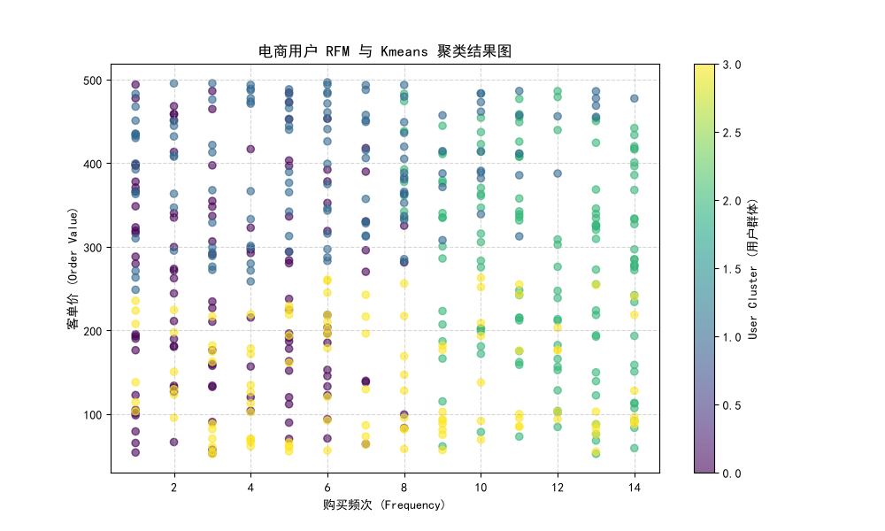

# 电商用户分群分析练习 (RFM + KMeans)

这是我自己写的一个数据分析小练习。主要思路是提取电商用户的 R、F、M 三个指标，然后用 KMeans 算法把用户分成 4 类，最后把结果画出来。

## 环境与依赖
* Python 3.12
* Pandas
* Scikit-learn
* Matplotlib

## 处理步骤
1. 算每个用户的最近一次购买时间、购买次数和总消费金额。
2. 因为这三个指标数值差太多，直接聚类效果不好，所以用 `StandardScaler` 做了标准化处理。
3. 跑 KMeans 把用户聚成了 4 类。
4. 用散点图把结果可视化，X 轴是购买频次，Y 轴是客单价。

## 结果展示

## 自己的一点看法
看图能明显看出不同颜色的点分成了几个群体，大概可以这样理解：
* 右上角（绿色）：买得多、单价也高。这部分估计是核心客户，得重点维护。
* 右下角（黄色）：买得多，但单价偏低。可以试着给他们推荐点利润高的商品，提升客单价。
* 左边（紫色/蓝色）：买得少，客单价也不高。这部分流失的风险比较大，需要搞点促销活动唤醒一下。

## 怎么跑这段代码
先装一下依赖：
pip install pandas numpy matplotlib scikit-learn

然后直接运行 `面试用.py` 就行。
